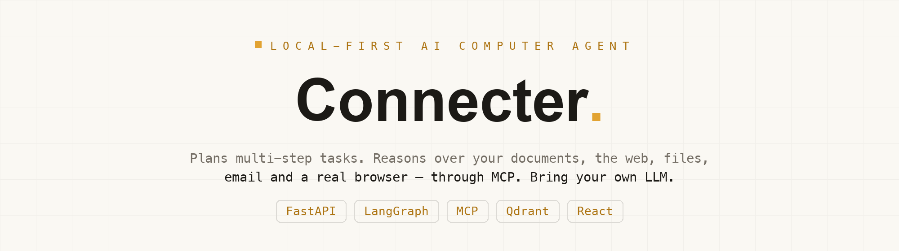
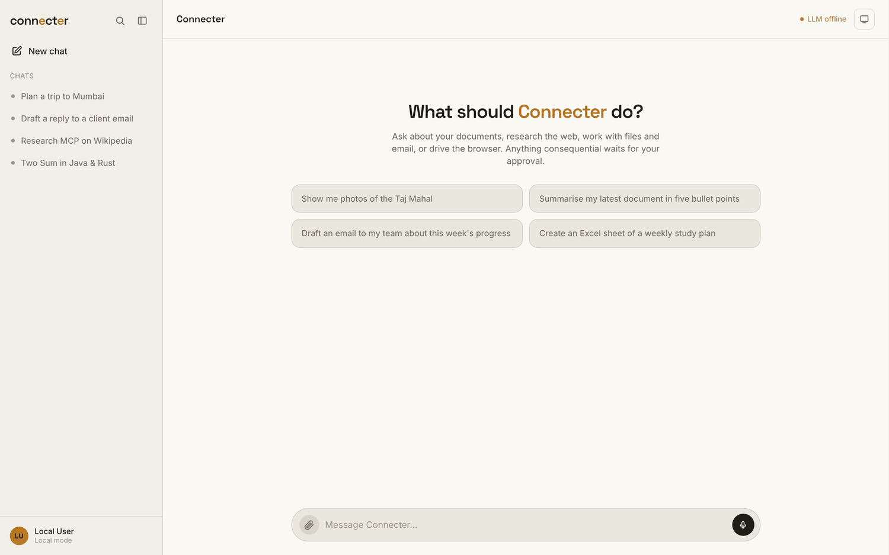

<p align="center">
  
</p>

<p align="center">
  A <strong>local-first AI computer agent</strong>. It plans multi-step tasks, uses your private
  documents (agentic RAG), the web, local files, email and a real browser through MCP servers —
  and pauses for your approval before doing anything consequential.
</p>

<p align="center">
  
  
  
  
  
  
  
</p>

<p align="center">
  <strong>Bring your own LLM</strong> — any OpenAI-compatible endpoint works: OpenAI, OpenRouter,
  Groq, Together, DeepSeek, or a fully local model via Ollama / LM Studio / vLLM.
</p>

---

## Contents

- [What it does](#what-it-does)
- [Demo](#demo)
- [Architecture](#architecture)
- [Bring your own model](#bring-your-own-model)
- [Quickstart](#quickstart)
- [Configuration](#configuration)
- [How a run works](#how-a-run-works)
- [API](#api)
- [Project structure](#project-structure)
- [Tech stack](#tech-stack)

---

## What it does

| | |
|---|---|
| 🧠 **Agentic planning** | A LangGraph state machine (`understand → plan → agent ⇄ execute → finalize`) binds only the tools a task needs, so even small local models stay accurate. It can request more capabilities mid-run and re-plans after repeated tool errors. |
| 📚 **Agentic RAG over your docs** | Upload PDF / DOCX / XLSX and ask questions with inline `[n]` citations. Hybrid retrieval — dense (`bge-small`) + sparse (BM25) fused with RRF, then cross-encoder rerank — runs fully on-device. |
| 🌐 **Real tools via MCP** | Four MCP servers: **files** (sandboxed workspace), **web** (search + page reading, SSRF-guarded), **email** (IMAP/SMTP), and a **browser** (Playwright). |
| 🖥️ **Browser / computer use** | Drives a real browser — navigates, clicks, types, scrolls — and streams a live view you can take over. Optional vision model lets it *see* the screen and click by coordinates. |
| 🧩 **Rich artifacts** | Answers render as tables, charts (Recharts), maps (Leaflet), images, and downloadable Office files with inline preview — not just text. |
| 🔒 **Human-in-the-loop** | Sending email, deleting or overwriting files, and submit/buy-style browser clicks pause the run for your approval. Checkpoints live in Postgres, so a pending approval survives a restart. |
| 💾 **Long-term memory** | Durable facts and preferences are learned across chats and recalled when relevant — scoped per user. |
| 👤 **Multi-user & isolated** | Optional email/password auth; each user sees only their own conversations, documents and runs (the vector index is partitioned per user in Qdrant). |

---

## Demo

<p align="center"></p>

---

## Architecture

```
React 19 + TS (Vite, Tailwind v4, TanStack Query, Zustand)
        │  HTTP + SSE  (/api, proxied by Vite in dev)
FastAPI ── LangGraph agent ── MCP client ──┬── File MCP     → ~/AI-Agent-Workspace (sandboxed)
   │            │                          ├── Web MCP      → search + page reading (SSRF-guarded)
   │            │                          ├── Email MCP    → IMAP/SMTP
   │            ├── RAG tools              └── Browser MCP  → Playwright (persistent profile)
   │            │     └── fastembed (bge-small + BM25) → Qdrant (hybrid, RRF) → cross-encoder rerank
   │            └── Memory → facts recalled on understand, written after finalize
   ├── PostgreSQL   (users, sessions, conversations, messages, runs, steps, tool calls, approvals, documents, memories)
   ├── Qdrant       (per-user document + memory vectors)
   └── Any OpenAI-compatible LLM   (cloud API or local — chosen in .env)
```

---

## Bring your own model

Connecter talks to the standard **OpenAI Chat Completions API** through the official `openai` SDK, so
*any* OpenAI-compatible endpoint works. You only set three variables:

```bash
LLM_BASE_URL=...   # the provider's /v1 base URL
LLM_MODEL=...      # the model id
LLM_API_KEY=...    # your key (use any placeholder for local servers)
```

| Provider | `LLM_BASE_URL` | Example `LLM_MODEL` | Notes |
|---|---|---|---|
| **OpenAI** | `https://api.openai.com/v1` | `gpt-4o-mini` | — |
| **OpenRouter** | `https://openrouter.ai/api/v1` | `anthropic/claude-3.5-sonnet` | 100+ models, one key |
| **Groq** | `https://api.groq.com/openai/v1` | `llama-3.3-70b-versatile` | very fast |
| **Together** | `https://api.together.xyz/v1` | `meta-llama/Llama-3.3-70B-Instruct-Turbo` | — |
| **DeepSeek** | `https://api.deepseek.com/v1` | `deepseek-chat` | — |
| **Ollama** (local) | `http://localhost:11434/v1` | `llama3.1` | key can be anything |
| **LM Studio** (local) | `http://localhost:1234/v1` | *(id shown in LM Studio)* | key `lm-studio` |
| **vLLM** (self-host) | `http://localhost:8000/v1` | *(your served model)* | — |

> **Tool calling is required.** The agent binds tools to the model, so pick a model that supports
> function/tool calling. On cloud providers a mid-size instruct model (70B-class) or GPT-4o-mini is
> a good baseline; locally, a 14B+ tool-calling model works well.

**Embeddings stay local by default** (`EMBEDDING_PROVIDER=fastembed`, in-process ONNX on CPU), so you
don't need an embeddings endpoint from your LLM provider. To use a provider's embeddings instead, set
`EMBEDDING_PROVIDER=openai` and point `EMBEDDING_MODEL` at a model it serves.

---

## Quickstart

**Prerequisites:** Docker, Python 3.11+, Node 20+, and an LLM endpoint (a cloud key, or a local
server like [Ollama](https://ollama.com) / [LM Studio](https://lmstudio.ai) with a tool-calling model loaded).

```bash
# 1. Configure — set LLM_BASE_URL / LLM_MODEL / LLM_API_KEY for your provider (see table above)
cp .env.example .env

# 2. Infrastructure — Postgres on :5433, Qdrant on :6333
docker compose up -d

# 3. Backend
cd backend
python3 -m venv .venv && .venv/bin/pip install -e ".[dev]"
.venv/bin/playwright install chromium
.venv/bin/alembic upgrade head
.venv/bin/uvicorn app.main:app --port 8010 --reload

# 4. Frontend
cd ../frontend && npm install && npm run dev      # http://localhost:5173
```

The first document you upload downloads the embedding and reranker models (~200 MB, once).

Run the tests with `cd backend && .venv/bin/pytest` (the agent-loop tests use the Postgres from Docker).

---

## Configuration

All settings live in `.env` (see [`.env.example`](.env.example) for the full list).

| Variable | Default | What it controls |
|---|---|---|
| `LLM_BASE_URL` / `LLM_MODEL` / `LLM_API_KEY` | LM Studio local | Your LLM endpoint — [any OpenAI-compatible provider](#bring-your-own-model) |
| `VISION_MODEL` | *(empty)* | Multimodal model for browser "computer use" (`look` tool). Empty = disabled |
| `EMBEDDING_PROVIDER` | `fastembed` | `fastembed` (local ONNX) or `openai` (your endpoint's `/v1/embeddings`) |
| `RERANKER_MODEL` | `ms-marco-MiniLM` | Cross-encoder for reranking; empty = disable |
| `AUTH_ENABLED` | `true` | `true` = email/password login + per-user isolation; `false` = single local user |
| `SECURE_COOKIES` | `false` | Set `true` when serving over HTTPS |
| `BROWSER_HEADLESS` | `true` | `true` = background (watch in-app); `false` = visible window to take over |
| `FILE_WORKSPACE` | `~/AI-Agent-Workspace` | Sandbox root the file tools are confined to |
| `AGENT_MAX_STEPS` | `15` | Max tool-use iterations per run |
| `CHECKPOINTER` | `postgres` | `postgres` (durable approvals) or `memory` (dev) |

---

## How a run works

`understand → plan → agent ⇄ (policy → approval? → execute → observe) → finalize`, one LangGraph node
per stage (`backend/app/agent/`).

- **Plan** picks which capabilities the task needs, and only those tools are bound to the LLM. This
  keeps small local models accurate. The agent can call `request_capability` to add more mid-run, and
  three consecutive tool errors trigger a re-plan.
- **Policy** (`agent/policy.py`) classifies each tool call. These pause the run through a LangGraph
  `interrupt()`: `send_email` / `reply_email`, `delete_file`, `write_file` onto an existing file,
  browser clicks on submit/buy/send-style elements, and `request_takeover`. Checkpoints live in
  Postgres, so a pending approval survives a backend restart.
- **Activity**: every stage emits safe, high-level steps (never chain-of-thought), stored in
  `agent_steps` and streamed over SSE (`GET /api/runs/{id}/events`).
- **Citations**: retrieved passages are numbered `[n]` across the whole run; the final answer keeps
  only the sources it actually cites.

---

## API

| Method | Path | Purpose |
|---|---|---|
| POST | `/api/auth/register` · `/api/auth/login` · `/api/auth/logout` | email/password session (httpOnly cookie) |
| GET | `/api/auth/me` | current user (the SPA's auth gate) |
| POST | `/api/conversations/{id}/messages` | start a run |
| GET | `/api/runs/{id}/events` | SSE live activity |
| POST | `/api/approvals/{id}/decision` | `{"decision": "approve" \| "reject"}` |
| POST | `/api/documents` | upload + index a document |
| POST | `/api/documents/search` | inspect the retrieval pipeline |
| GET · DELETE | `/api/memories` · `/api/memories/{id}` | list / forget long-term memories |
| GET | `/api/health` | DB, Qdrant, LLM and MCP server status |

---

## Project structure

```
Connecter/
├── backend/
│   ├── app/
│   │   ├── agent/        # LangGraph nodes, policy, prompts, runner
│   │   ├── api/          # FastAPI routers (auth, conversations, runs, documents, memory…)
│   │   ├── llm/          # OpenAI-compatible provider + vision
│   │   ├── memory/       # long-term memory service
│   │   ├── rag/          # embeddings, hybrid retrieval, rerank
│   │   └── db/           # SQLAlchemy models, session
│   ├── mcp_servers/      # file / web / email / browser MCP servers
│   └── alembic/          # migrations
├── frontend/             # React 19 + Vite + Tailwind v4 SPA
└── docker-compose.yml    # Postgres + Qdrant
```

---

## Tech stack

**Backend** — FastAPI · LangGraph · MCP · SQLAlchemy 2 (async) + Postgres · Qdrant · fastembed
(bge-small + BM25) · cross-encoder rerank · Playwright · Alembic · argon2 · the `openai` SDK.

**Frontend** — React 19 · TypeScript · Vite · Tailwind CSS v4 · TanStack Query · Zustand · Recharts ·
react-leaflet · react-markdown + rehype-highlight.

---

<p align="center"><sub>Built as a portfolio project — a production-shaped, local-first agent you can run end to end.</sub></p>
